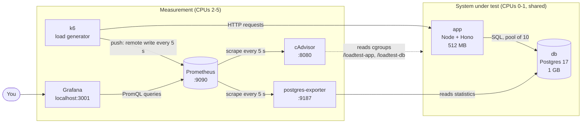
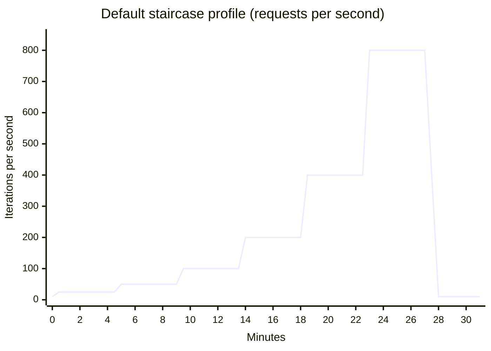
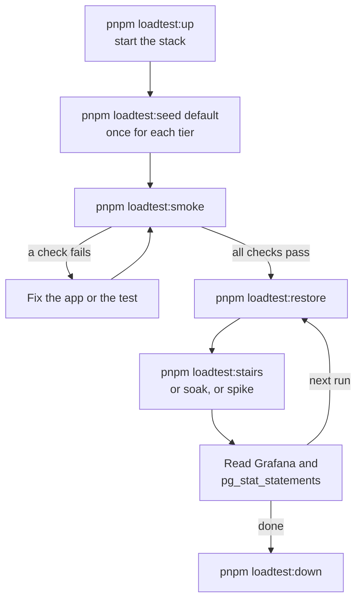

# How the load tests work

This document explains the load test stack for reddit-lite. It shows how the parts connect, what each tool does, and how to run a test and read the results. For a short list of commands, see [README.md](README.md).

The tests run on local Docker. The app and db containers have CPU and memory limits that match a 2 vCPU / 2 GB droplet. The tests find the request rate at which the site stops keeping up. They also show which part stops first: the app, the database, or the connection pool between them.

## Architecture

Two groups of containers run together. The system under test is the app and the database, with fixed limits. The measurement group creates the load, collects the metrics, and shows them.



The metrics move in two directions. k6 pushes its own metrics to Prometheus. Prometheus pulls the database and container metrics from the two exporters. An exporter is a small service that turns internal statistics into metrics that Prometheus can read.

## The tools and their responsibilities

| Tool | Responsibility | Files |
|---|---|---|
| Docker Compose | Starts all containers. The base file has the app and db. The overlay adds limits, Postgres tuning, and the monitoring services. | `docker-compose.yml`, `docker-compose.loadtest.yml`, `scripts/loadtest/compose.sh` |
| app | The system under test. Runs with `NODE_ENV=production` and a heap limit of about 75% of its memory. | `Dockerfile`, `src/` |
| db (Postgres) | The system under test. Loads `pg_stat_statements` and logs each query that takes more than 200 ms. | `docker-compose.loadtest.yml` |
| Seed generator | Fills the database with mock data, exports CSV files for k6, and saves a snapshot. | `scripts/loadtest/seed.sh`, `scripts/loadtest/seed.sql` |
| Restore | Loads the snapshot again, so each run starts with the same data. | `scripts/loadtest/restore.sh` |
| k6 | Creates the load. Each virtual user acts as one bot on the site. | `loadtest/k6/`, `scripts/loadtest/k6.sh` |
| Prometheus | Stores all metrics as time series for 7 days. | `loadtest/prometheus.yml` |
| postgres-exporter | Turns Postgres statistics into metrics: transactions, connections, cache hits, locks, rows. | `docker-compose.loadtest.yml` |
| cAdvisor | Measures CPU, memory, CPU pressure, and I/O pressure of the app and db containers. | `docker-compose.loadtest.yml` |
| Grafana | Shows three dashboards in the "Load test" folder. | `loadtest/grafana/` |

### Docker Compose

`scripts/loadtest/compose.sh` joins `docker-compose.yml` and `docker-compose.loadtest.yml` into one stack. If `loadtest/.env` exists, the script also passes it as the env file. All other scripts in `scripts/loadtest/` use this helper. The k6 service is in the `k6` profile, so `up` does not start it. The `k6.sh` script starts it once for each test run.

### The app and the database

The overlay sets the limits from these variables. You can change them in `loadtest/.env`.

| Variable | Default | Meaning |
|---|---|---|
| `SUT_CPUSET` | `0-1` | Docker VM CPUs that the app and db share, like the 2 vCPUs of the droplet |
| `TOOLS_CPUSET` | `2-5` | Docker VM CPUs for Prometheus, Grafana, the exporters, and k6. Must not overlap `SUT_CPUSET` |
| `APP_MEM` | `512m` | Memory limit for the app container |
| `APP_HEAP_MB` | `384` | Node heap limit, about 75% of `APP_MEM` |
| `DB_MEM` | `1g` | Memory limit for the db container |
| `DB_SHARED_BUFFERS` | `256MB` | Postgres `shared_buffers`, about 25% of `DB_MEM` |
| `DB_EFFECTIVE_CACHE_SIZE` | `768MB` | Postgres `effective_cache_size`, about 75% of `DB_MEM` |

The CPU limit is a cpuset (a list of CPUs that the processes can run on), not a time quota. In production the app and db run on one droplet and share its 2 vCPUs, so here they share 2 CPUs too. When one of them is idle, the other can use both CPUs. A time quota (`cpus: 1.0`) lets processes run on all VM CPUs at once and then stops them until the next 100 ms period. Those pauses add latency that a real droplet does not have.

### Seed generator and restore

`seed.sh` runs the migrations and then runs `seed.sql`. The SQL file creates users, posts, nested comments, votes, and likes with `generate_series`. Low post ids get more comments, so some posts become hot posts with large comment trees. You pick the size with a tier.

| Tier | Users | Posts | Comments | Votes | Likes |
|---|---|---|---|---|---|
| `S` | 5,000 | 50,000 | 250,000 | 250,000 | 500,000 |
| `default` | 20,000 | 400,000 | 2,000,000 | 2,000,000 | 4,000,000 |
| `L` | 200,000 | 5,000,000 | 50,000,000 | 25,000,000 | 50,000,000 |

After the load, the script writes these files to `loadtest/data/`:

- `bots.csv`: the user names that the k6 bots log in as.
- `posts_hot.csv`: the top 1% of posts by comment count, at most 2,000.
- `posts_cold.csv`: up to 50,000 random posts with fewer than 50 comments.
- `comments.csv`: up to 100,000 random comment ids.
- `meta.json`: the tier, the post count, and the page size.
- `snapshot.dump`: a `pg_dump` of the database.

The write actions of a test add votes, comments, and posts. So the data after a run is different from the data before it. `restore.sh` loads `snapshot.dump`, runs `ANALYZE` to rebuild the planner statistics, and resets `pg_stat_statements`. Then the next run starts with the same data and with empty query statistics.

### k6

k6 runs JavaScript test scripts and sends HTTP requests to `http://app:3000` inside the Docker network. A virtual user (VU) is one k6 worker that runs the script in a loop. In these tests, one VU is one bot.

The shared code is in `loadtest/k6/lib.js`:

- 30% of the bots stay anonymous and only read. The other bots log in once with a name from `bots.csv` and keep the session cookie.
- Each iteration picks one action from a weighted mix. The mix is about 90% reads and 10% writes.
- Each POST sends an `Origin` header, because the CSRF check in the app rejects a form POST without it.
- Each POST uses `redirects: 0`, so k6 measures the write alone and not the page after the redirect.
- Each request has an `action` tag. The dashboards group the latency by this tag.

`scripts/loadtest/k6.sh` runs a script in the k6 container. It tags all metrics of the run with `testid=<script>-<time>`, and sends them to Prometheus. It saves all files of the run in the folder `loadtest/results/<script>-<time>/`: the k6 summary, every k6 sample as `k6.csv.gz`, and `meta.json`. The file `meta.json` records what ran and the real app and db configuration.

### Prometheus, the exporters, and Grafana

Prometheus scrapes `postgres-exporter:9187` and `cadvisor:8080` every 5 seconds. It also accepts the k6 metrics on `/api/v1/write`, because the overlay starts it with `--web.enable-remote-write-receiver`. k6 sends the p50, p95, p99, and max of each latency every 5 seconds.

cAdvisor needs a special setup on Docker Desktop. It cannot read containers from the containerd image store. So the overlay puts the app and db in fixed cgroups, `/loadtest-app` and `/loadtest-db`, and cAdvisor reads these cgroups directly. A cgroup is the Linux group that holds the CPU and memory limits of a container.

Grafana loads the Prometheus data source and the three dashboards from files at start. It allows anonymous access with the admin role, so there is no login page.

## The traffic model

Each iteration of a bot does one action. The weights are relative.

| Action | Weight | Request | What it tests |
|---|---|---|---|
| `feed` | 40 | `GET /?sort=new\|top&page=1..5` | The front page |
| `deep_feed` | 5 | `GET /?sort=new&page=6..N` | Deep pagination with large offsets |
| `cold_post` | 25 | `GET /p/:id` | A post with a small comment tree |
| `hot_post` | 10 | `GET /p/:id` | A post with a large comment tree |
| `user_page` | 5 | `GET /u/:name` | A user profile |
| `thread` | 5 | `GET /c/:id` | One comment thread |
| `vote` | 4 | `POST /p/:id/vote` | A vote on a post |
| `like` | 3 | `POST /c/:id/like` | A like on a comment |
| `comment` | 2.5 | `POST /p/:id/comments` | A new comment, 30% of them on hot posts |
| `submit` | 0.5 | `POST /submit` | A new post |

If an anonymous bot picks a write action, it reads the feed in its place.

The main tests use an open model. In an open model, k6 starts new iterations at a set rate. The app speed does not change this rate. Real users also do not wait for other users. So when the app slows down, the rate stays the same, and you see the problem as higher latency, more errors, and more active VUs. If k6 has no free VU for a new iteration, it drops the iteration and counts it in `dropped_iterations`.

## The test profiles

| Script | Purpose | Executor | Variables and defaults |
|---|---|---|---|
| `smoke` | Make sure that each action works before a large test | `constant-vus`, 1 VU | `DURATION=1m` |
| `stairs` | Find the breaking rate | `ramping-arrival-rate` | `STEPS=25,50,100,200,400,800`, `RAMP=30s`, `HOLD=4m`, `PRE_VUS=200`, `MAX_VUS=2000` |
| `soak` | Find memory and connection leaks over time | `constant-arrival-rate` | `RATE=50`, `DURATION=1h`, `PRE_VUS=100`, `MAX_VUS=1000` |
| `spike` | See if the site recovers after a sudden burst | `ramping-arrival-rate` | `BASE_RATE=20`, `PEAK=200` (the spike goes to 2 times `PEAK`) |

The staircase test raises the rate in steps and holds each step. The hold gives the app, the pool, and the Postgres cache time to settle, so each step gives a stable value. At the end, the rate drops to 10 requests per second for 4 minutes. This part shows whether the site recovers. The chart shows the default profile. One run takes about 31 minutes.



Use the soak test at about 70% of the breaking rate that the staircase test found.

## The workflow



## Start the project

### Before you start

1. Install Docker Desktop, Node 24 or later, and pnpm.
2. In Docker Desktop, open Settings > Resources. Set at least 6 CPUs and 6 GB of memory. The app and db share CPUs 0 and 1. The monitoring containers and k6 run on CPUs 2 to 5.
3. If you want other limits, copy the example file and change the values:

   ```bash
   cp loadtest/.env.example loadtest/.env
   ```

### Start the stack

Run all commands from the repo root.

1. Start the containers. The first start builds the app image and downloads the monitoring images.

   ```bash
   pnpm loadtest:up
   ```

2. Open these addresses to make sure that the stack runs:

   | Service | Address |
   |---|---|
   | App | http://localhost:3100 |
   | Grafana | http://localhost:3001 |
   | Prometheus | http://localhost:9090 |

3. In Prometheus, open Status > Target health. Make sure that the `postgres` and `cadvisor` targets are up.

### Load the mock data

Warning: this command deletes all rows in the app tables of the local Docker database. The development stack uses the same database volume.

```bash
pnpm loadtest:seed default
```

Use `S` for a fast first try. The `default` tier takes a few minutes. If you change the tier, run the seed again. For the same tier, use the restore script.

## Start load testing

1. Run the smoke test. All checks must pass before you continue.

   ```bash
   pnpm loadtest:smoke
   ```

2. Restore the snapshot:

   ```bash
   pnpm loadtest:restore
   ```

3. Run the staircase test:

   ```bash
   pnpm loadtest:stairs
   ```

4. Before each next run, restore the snapshot again.

To change a variable, add `-e NAME=VALUE` after the command. For example, this is a short staircase:

```bash
pnpm loadtest:stairs -e STEPS=10,20 -e HOLD=1m
```

This soak test runs at 70 requests per second for 30 minutes:

```bash
pnpm loadtest:soak -e RATE=70 -e DURATION=30m
```

When a run ends, k6 prints a summary in the terminal. The run folder `loadtest/results/<script>-<time>/` then fills in this order:

1. k6 writes `summary.json` and `k6.csv.gz`.
2. `scripts/loadtest/run-meta.ts` adds the end time, the exit code, and the container state after the run to `meta.json`.
3. `scripts/loadtest/prom-summary.ts` reads the run from Prometheus. It saves the db, CPU, and memory numbers to `prom.json`, and the raw 5 s points to `prom-series.json`.
4. `scripts/loadtest/report.ts` turns `k6.csv.gz` into `timeseries.json` and builds `report.html`.

A threshold failure does not stop the run, because the thresholds use `abortOnFail: false`. The staircase test must go past the failure point to show what happens there.

### Stop the stack

```bash
pnpm loadtest:down
```

The data stays in the `reddit-lite-loadtest_pgdata` volume. The load test stack is a separate Compose project, so the development database keeps its own data.

## Monitor the metrics

Open Grafana at http://localhost:3001, then open Dashboards > Load test. Set the time range to the time of your run. The dashboards have no run selector. To see one run only, open Explore and query a k6 metric with a `testid` filter. For example: `k6_http_reqs_total{testid="stairs-20261118-101500"}`. The terminal output of `k6.sh` shows the name of the run.

### k6 load test

| Panel | What it shows |
|---|---|
| Request rate | Requests per second, in total and by action. It follows the staircase while the app keeps up. |
| Active VUs and dropped iterations | VUs that wait for a response, and iterations that k6 did not start. Many active VUs mean slow responses. |
| p95 latency by action | 95% of the requests of each action are faster than this value. The threshold is 500 ms for all requests and 1000 ms for `hot_post`. |
| p99 latency by action | The slowest 1% of the requests. The threshold is 1500 ms. |
| Error rate | The share of failed requests (threshold 1%) and the share of failed checks. |
| Responses by status | Responses per second by HTTP status. 403 means a test error with the `Origin` header. 5xx means the app failed. |

### Postgres

| Panel | What it shows |
|---|---|
| Transactions per second | Commits and rollbacks. Commits rise with the load until the database or the pool is the limit. |
| Connections by state | `active`, `idle`, and `idle in transaction` connections. The app pool has 10 connections. |
| Cache hit ratio | The share of reads from memory. Below 99% means that reads go to disk. |
| Locks by mode | Locks that sessions hold or wait for. Comments on hot posts take a `FOR UPDATE` lock on the post row. |
| Rows read and written per second | Rows that queries fetch and insert. A large read count for a small request rate points to a missing index. |
| Deadlocks and temp files | Deadlocks, and bytes that sorts write to disk because they do not fit in memory. |

### Containers (app and db)

| Panel | What it shows |
|---|---|
| CPU use (1.0 = one CPU) | CPU use of the app and the db. A flat line at the limit means that the container uses all of its CPU. |
| CPU pressure | The share of time that tasks wait for CPU. Above 0 means that the CPU limit slows the container. |
| Memory | Working set and RSS. A line that rises during a soak test points to a leak. |
| I/O pressure | The share of time that tasks wait for disk. |

### Find the slow queries

Show the 15 queries with the largest total time since the last restore:

```bash
sh scripts/loadtest/compose.sh exec db psql -U postgres -d reddit_lite -c "SELECT calls, round(mean_exec_time::numeric, 1) AS mean_ms, round(total_exec_time::numeric) AS total_ms, left(query, 100) AS query FROM pg_stat_statements ORDER BY total_exec_time DESC LIMIT 15"
```

Show each query that took more than 200 ms:

```bash
sh scripts/loadtest/compose.sh logs db
```

### Find the limit

1. On the k6 dashboard, find the first step with a p95 latency above 500 ms or an error rate above 1%. This rate is the breaking rate.
2. If dropped iterations are above 0 before that step, increase `MAX_VUS` and run the test again. If k6 has too few VUs, the latency numbers are not correct.
3. At the time of that step, compare the app CPU, the db CPU, and the connection states.
4. Find the cause in the "Reading the results" table in [README.md](README.md#reading-the-results).
5. If the db is the limit, find the query with `pg_stat_statements`.
